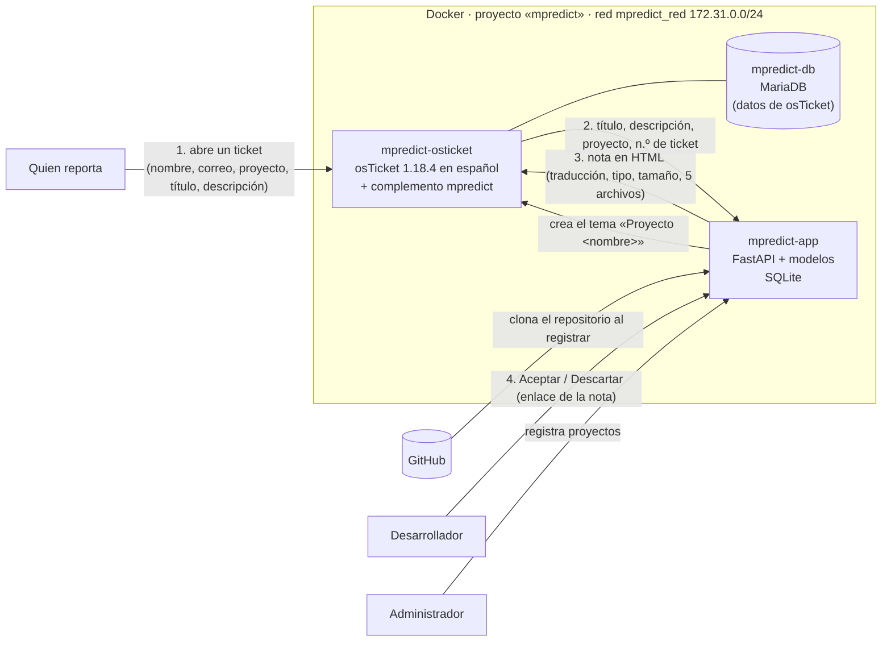

# mpredict

**Asistente de pre-análisis de solicitudes de mantenimiento para proyectos hechos con Django.**

Cuando alguien abre un ticket en osTicket, mpredict:

- traduce al inglés el título y la descripción si vienen en español;
- predice el **tipo** de mantenimiento (Bug / New feature / Cleanup/optimization), con sus probabilidades;
- predice el **tamaño** del cambio (pequeño / mediano / grande, relativo al proyecto), con su rango de líneas;
- predice **dónde** ocurrirá el cambio: los 5 archivos Python más probables, con su puntaje.

El análisis llega al ticket como una nota interna en español. El desarrollador lo revisa y lo **acepta o lo descarta**:
mpredict sugiere, no decide.

> Proyecto universitario de Ingeniería de Sistemas (TAIS). Los modelos de tipo y tamaño salen de
> `maint-predict-docs`, y el método de localización M92 lo aportó un compañero del equipo
> (ver [Origen de los archivos](#origen-de-los-archivos)).

---

## Manual rápido

### Direcciones

| Qué | Dirección | Quién |
|---|---|---|
| **Portal de osTicket**: abrir un ticket | http://127.0.0.1:8680/ | Quien reporta (sin cuenta) |
| **Panel de agentes de osTicket**: lista y detalle de tickets, y administración | http://127.0.0.1:8680/scp/ | Desarrolladores y administrador (con contraseña) |
| **mpredict, pantalla «Proyectos»**: registrar proyectos | http://127.0.0.1:8600/proyectos | Administrador |
| **mpredict, documentación de la API** | http://127.0.0.1:8600/docs | Para revisar o probar la API |

Solo se abren desde la misma computadora (`127.0.0.1`). Docker Desktop debe estar abierto.

### Encender y apagar

Desde la carpeta del repositorio, en PowerShell:

```powershell
docker compose up -d      # encender (la primera vez, ver «Cómo levantarlo con Docker»)
docker compose stop       # apagar; no se pierde nada
docker compose ps         # ver si los tres contenedores están en marcha
```

Tras `up -d`, espera 20–30 segundos antes de abrir las direcciones.

### Entrar como administrador

El portal no tiene botón para entrar: abre **http://127.0.0.1:8680/scp/** e inicia sesión con
`OSTICKET_ADMIN_USER` y `OSTICKET_ADMIN_PASS` de tu archivo `.env`. Arriba a la derecha está el enlace
**Panel Administrador**; desde allí, **Panel de agente** vuelve al panel de agentes.

### Dónde está cada cosa

| Quiero… | Dónde |
|---|---|
| Registrar un proyecto | http://127.0.0.1:8600/proyectos → nombre y URL de GitHub → **Registrar** → **Confirmar carpetas** |
| Abrir un ticket como quien reporta | http://127.0.0.1:8680/ → **Abrir un nuevo Ticket** → elegir el proyecto en «Temas de ayuda» |
| Abrir un ticket sin escribir nombre y correo | `/scp/` → **Nuevo Ticket** → buscar a la persona → **Continue** |
| Ver los tickets | `/scp/` → pestaña **Tickets** → **Abrir** (todos los abiertos; «Mis Tickets» son solo los asignados a ti) |
| Ver el análisis de un ticket | Clic en el número o el asunto → nota **«Análisis mpredict»** bajo el mensaje |
| Aceptar o descartar el análisis | Enlaces **Aceptar** / **Descartar** al final de la nota (piden confirmación) |
| Crear desarrolladores (agentes) | `/scp/` → Panel Administrador → **Agentes** → Agentes → Añadir nuevo agente (rol «Solo consulta (mpredict)») |
| Ver el tema de ayuda y el complemento | Panel Administrador → **Administrar** → Temas de ayuda / Plugins |

---

## Índice

0. [Manual rápido](#manual-rápido)
1. [Arquitectura](#arquitectura)
2. [Las 5 pantallas](#las-5-pantallas)
3. [Cómo levantarlo con Docker](#cómo-levantarlo-con-docker)
4. [Cómo registrar un proyecto](#cómo-registrar-un-proyecto)
5. [Abrir tickets y la nota «Análisis mpredict»](#abrir-tickets-y-la-nota-análisis-mpredict)
6. [Cómo reemplazar un modelo](#cómo-reemplazar-un-modelo)
7. [osTicket reducido al mínimo](#osticket-reducido-al-mínimo)
8. [Cómo funciona por dentro](#cómo-funciona-por-dentro)
9. [Comprobaciones](#comprobaciones)
10. [Prueba completa con EvaP](#prueba-completa-con-evap)
11. [Limitaciones](#limitaciones)
12. [Desarrollo sin Docker](#desarrollo-sin-docker)
13. [Estructura y origen de los archivos](#estructura-y-origen-de-los-archivos)

---

## Arquitectura



| Contenedor | Qué es | Dirección desde Windows |
|---|---|---|
| `mpredict-app` | mpredict: API, pantalla «Proyectos», modelos y SQLite | http://127.0.0.1:8600 |
| `mpredict-osticket` | osTicket 1.18.4 en español, con el complemento mpredict | http://127.0.0.1:8680 |
| `mpredict-db` | MariaDB 10.11, la base de datos **de osTicket** | (no se publica) |

Volúmenes: `mpredict_datos` (SQLite, repositorios clonados e índices de M92), `mpredict_osticket_estado`
(configuración de osTicket) y `mpredict_db_datos` (base de datos de osTicket).

**Qué guarda mpredict.** Solo los proyectos y el registro de cada análisis: qué se predijo, con qué versión
de cada modelo, en qué commit y si se aceptó o descartó. **No** guarda el texto de los tickets, ni nombres,
ni correos: las personas viven en osTicket.

---

## Las 5 pantallas

| # | Pantalla | Quién | Dónde |
|---|---|---|---|
| 1 | **Abrir un ticket** (portal): nombre, correo, proyecto, título y descripción | Quien reporta | http://127.0.0.1:8680/ |
| 2 | **Lista de tickets** (solo consulta) | Desarrollador | http://127.0.0.1:8680/scp/ |
| 3 | **Detalle del ticket**: mensaje y nota «Análisis mpredict» con los enlaces Aceptar / Descartar | Desarrollador | http://127.0.0.1:8680/scp/ → un ticket |
| 4 | **Usuarios y agentes**: crear las personas | Administrador | http://127.0.0.1:8680/scp/ → Panel Administrador → Agentes |
| 5 | **Proyectos** (la única pantalla propia de mpredict): registrar, confirmar carpetas, ver estado, actualizar | Administrador | http://127.0.0.1:8600/proyectos |

Los agentes también pueden abrir tickets desde el panel (**Nuevo Ticket**), buscando a una persona ya existente
para no escribir su nombre y correo cada vez. El análisis llega igual: osTicket emite la misma señal
`ticket.created` para los tickets del portal y del panel. Para eso el agente necesita el permiso «Crear tickets»,
que el rol «Solo consulta (mpredict)» no tiene.

---

## Cómo levantarlo con Docker

Requisitos: Docker Desktop y unos 6 GB libres (la imagen de mpredict incluye torch y tres modelos de Hugging Face).

```powershell
cd maint-predict
copy .env.example .env       # y edita .env: contraseñas y secreto (no se sube a GitHub)
docker compose build         # la primera vez, 10-20 minutos
docker compose up -d
docker compose logs osticket # debe terminar en «[mpredict] osTicket disponible en http://127.0.0.1:8680/»
```

- Agentes y administración de osTicket: http://127.0.0.1:8680/scp/ con `OSTICKET_ADMIN_USER` y `OSTICKET_ADMIN_PASS` de `.env`.
- mpredict: http://127.0.0.1:8600/proyectos (y la documentación de su API en http://127.0.0.1:8600/docs).

En el **primer arranque**, el contenedor de osTicket ejecuta su instalador oficial en español y luego
`docker/osticket/configurar.php`, que lo deja reducido al mínimo y con el complemento activo. Los siguientes
arranques solo recuperan la configuración.

| Comando | Efecto |
|---|---|
| `docker compose stop` / `start` | Detiene / vuelve a encender; todo se conserva |
| `docker compose up -d --build app` | Reconstruye solo mpredict (tras cambiar su código o un modelo) |
| `docker compose down` | Elimina los contenedores; los datos quedan en los volúmenes |
| `docker compose down -v` | Elimina contenedores **y datos** (el próximo arranque instala desde cero) |

Los nombres, puertos (8600, 8680), la red `172.31.0.0/24` y los volúmenes `mpredict_*` se eligieron tras comprobar
que no chocan con otros proyectos de la misma máquina. Ningún comando afecta a otros contenedores.

---

## Cómo registrar un proyecto

En http://127.0.0.1:8600/proyectos, escribe el **nombre** (por ejemplo `EvaP`) y la **URL de GitHub**
(`https://github.com/e-valuation/EvaP`) y pulsa **Registrar**. Todo ocurre en segundo plano:

| Estado | Qué está pasando |
|---|---|
| descargando | `git clone` **completo** (sin `--depth`: los cortes necesitan el historial desde 2020) |
| por confirmar carpetas | mpredict propone las carpetas de código; pulsa **Confirmar carpetas**, corrige si hace falta y confirma |
| preparando | cortes de tamaño, índice de M92 y tema de ayuda en osTicket |
| listo / listo con aviso | ya se pueden abrir tickets de ese proyecto |
| error | con el mensaje; **Actualizar** lo reintenta |

**Carpetas de código propuestas.** Las carpetas de primer nivel que contienen apps de Django: las que tienen
`apps.py` o `models.py`, y las apps propias de `INSTALLED_APPS`, leído del archivo de configuración **sin
ejecutar** código del repositorio. Para EvaP sale `evap/`. En Baby Buddy salen 6 de las 7 carpetas que usó
`preparar_datos.py`; falta `babyblotter/`, que no existe desde 2017 y no cambia los cortes (0 commits desde 2020).

**Cortes de tamaño.** La misma regla que `maint-predict-docs/preparar_datos.py`: commits de la rama principal
contra su primer padre, desde 2020, sin bots (dependabot, renovate), contando las líneas de las carpetas de código
salvo pruebas. Pequeño ≤ percentil 30; grande > percentil 80. Con **menos de 100** commits con código los cortes se
calculan, pero el estado es «listo con aviso» y la nota dice que el rango es poco fiable; con **menos de 30** no se
calculan y la nota muestra la categoría sin rango.

**Tema de ayuda.** mpredict crea en osTicket el tema **«Proyecto &lt;nombre&gt;»** (osTicket exige 5 caracteres o
más) y guarda la relación por su id. Así el proyecto aparece en la lista del portal.

**Actualizar** trae los commits nuevos y recalcula cortes e índice con las mismas carpetas.

---

## Abrir tickets y la nota «Análisis mpredict»

1. En el portal (http://127.0.0.1:8680/) → **Abrir un nuevo Ticket**: correo, nombre, **Temas de ayuda =
   Proyecto EvaP**, resumen (título) y detalles.
2. Al crearse el ticket, el complemento envía a mpredict el título, la descripción, el proyecto y el número de
   ticket. Un análisis tarda de 1 a 5 s (más si hay que traducir).
3. En el panel (http://127.0.0.1:8680/scp/), el ticket tiene la nota interna **«Análisis mpredict»**:
   traducción (si la hubo), tipo con probabilidades, tamaño con su rango en ese proyecto, 5 archivos Python con
   su puntaje, los avisos y los enlaces **Aceptar · Descartar**.

   El tipo se muestra con el nombre de la norma ISO/IEC 14764 y, entre paréntesis, la etiqueta del modelo:
   **Correctivo (Bug)**, **Perfectivo (New feature)** o **Preventivo (Cleanup/optimization)**. La equivalencia
   está en `mpredict/nota.py`; en la base de datos se guarda la etiqueta del modelo.
4. Cada enlace lleva un código aleatorio único por análisis y **pide confirmación** antes de guardar. La decisión se
   guarda en mpredict, en el registro del análisis; se puede cambiar después.

Si mpredict falla, el proyecto no está listo o tarda más de **30 s** (configurable en el complemento), **el ticket se
crea igual** y la nota es «Análisis mpredict: no disponible», con el motivo.

---

## Cómo reemplazar un modelo

`config/mpredict.toml` indica la carpeta de cada modelo:

```toml
[modelos]
tipo = "modelos/tipo"
tamano = "modelos/tamano"
```

Cada carpeta tiene `modelo.joblib` y `ficha.json`. Para cambiar de modelo:

1. reemplaza la carpeta (o apunta la línea a otra carpeta) con el `modelo.joblib` y la `ficha.json` nuevos;
2. `docker compose up -d --build app`.

Los modelos se cargan **una vez** al arrancar. En ese momento mpredict compara las versiones de `ficha.json`
(Python, scikit-learn, sentence-transformers, torch, pandas, numpy, joblib, maint_predict) con las instaladas y
avisa si no coinciden, en el registro (`docker compose logs app`) y en la pantalla Proyectos. Una diferencia en
scikit-learn se marca como **grave**: puede cambiar cómo se lee `modelo.joblib`. La imagen fija las versiones de las
fichas actuales (scikit-learn 1.9.1, Python 3.12.4).

`maint_predict.py` se copió **sin renombrar**: `modelo.joblib` necesita importar el módulo con ese nombre. Cómo se
entrena un modelo nuevo está en `maint-predict-docs/DOCUMENTACION.md`, sección 10.

---

## osTicket reducido al mínimo

Todo se hace en el primer arranque, con las mismas opciones del panel de administración. **No se modifica el
código de osTicket.** Se verificó contra el código de osTicket v1.18.4.

| Qué | Cómo |
|---|---|
| Idioma | Paquete oficial `es_ES.phar` de la serie 1.18 (`downloads.osticket.com/lang/1.18.x/`), verificado con MD5 al construir la imagen |
| Registro de clientes | Desactivado: todos son invitados (no hay «Iniciar sesión» ni «Registrarse») |
| Base de conocimiento, respuestas predefinidas, captcha, avatares, adjuntos | Desactivados |
| Correos automáticos (avisos y respuestas) | Desactivados (no hay cuenta de correo) |
| Teléfono en el formulario | Campo desactivado. La prioridad ya no se muestra a quien reporta en 1.18.4 |
| Título | Hasta **255** caracteres (osTicket trae 50 y recorta los títulos largos) |
| Temas de ayuda por defecto | Desactivados: solo aparecen los «Proyecto ...» |
| SLA | Sin cron, nunca se marcan tickets como vencidos (el plan por defecto no se puede borrar) |
| Rol de agente | «Solo consulta (mpredict)», sin ningún permiso |

**Qué sigue visible igualmente** (no se puede quitar sin cambiar el código de osTicket):

- Portal: «Ver estado de un ticket», «Inicio», la etiqueta **«Temas de ayuda»** (por eso cada opción se llama
  «Proyecto ...») y el logo «Support Center» (es una imagen; se puede cambiar a mano en Administrar → Empresa).
- Panel de agentes: las pestañas Panel de control, Tareas y Base de conocimientos (vacías y sin botones para crear
  con el rol mínimo), y en el detalle del ticket, Imprimir y Publicar nota interna.
- Algunos textos en inglés que el paquete `es_ES` oficial no traduce (por ejemplo, «Lookup or create a user»).

**Cómo se crea el tema de ayuda.** La API de osTicket solo crea tickets. El complemento añade la ruta
`POST /api/mpredict/tema` con la señal `api`, el mecanismo de osTicket para que un complemento registre rutas en su
API. La ruta usa `Topic::__create`, la misma función que usa el instalador de osTicket, y exige el secreto
`MPREDICT_SECRETO` de `.env`.

---

## Cómo funciona por dentro

**Traducción** (`mpredict/traduccion.py`, modelo local `Helsinki-NLP/opus-mt-es-en`). Para el título y la
descripción por separado:
1. protege el código: bloques ``` y `{{{ }}}`, tracebacks, `código en línea`, URLs, rutas y nombres técnicos como
   `QuerySet.filter()`, `__init__`, `snake_case` o `CamelCase`;
2. detecta el idioma sobre el texto **sin código** (lingua, solo español e inglés). Si ya está en inglés, no traduce;
3. traduce línea por línea y comprueba que todo el código vuelve **intacto**. Si el modelo deforma un marcador,
   traduce solo los trozos de texto entre las partes protegidas.

**Tipo y tamaño** (`maint_predict.py` + `modelos/`). TF-IDF, embeddings `all-MiniLM-L6-v2` y regresión logística,
sobre el texto en inglés. El rango de líneas sale de los cortes del proyecto.

**Dónde: M92** (`mpredict/localizacion.py`). Adaptación del módulo M92 (BM25 80 % + embeddings multilingües 20 %
con fusión RRF; 6 fragmentos iniciales + 12 guiados por BM25 por archivo). **No cambian su lógica ni sus
parámetros**: se importan de `mpredict/m92_original.py`, copia sin cambios. Lo que cambia:
- es una función que recibe título, descripción (ya traducida) y proyecto;
- los embeddings de **todos** los fragmentos se calculan **una vez** al registrar el proyecto y se guardan; en cada
  ticket solo se busca;
- la consulta es la de `query_text` del original: título + `"\n"` + `texto_modelo`;
- **la entrada cambia respecto al original:** mpredict indexa solo los `.py` de las carpetas de código confirmadas,
  sin pruebas ni migraciones. El original indexaba todos los `.py` del repositorio (en EvaP: 86 archivos frente a
  360).

---

## Comprobaciones

Ejecutadas el 09-11-2026 en Windows 11, con `scripts/` y los datos de `maint-predict-docs` y `eval-repos`.

| # | Comprobación | Script | Resultado |
|---|---|---|---|
| 1 | Los modelos copiados reproducen `predicciones_evap.csv` (788 issues de EvaP) | `verificar_modelos.py` | Clase igual en **788 de 788** (tipo y tamaño); probabilidades idénticas (diferencia máxima 0,0000) |
| 2 | Cortes de EvaP en el commit 8c2ac6b6 frente a `cortes_tamano.json` | `verificar_cortes.py` | **11 de 11** campos iguales: ≤ 9 / 10–202 / > 202, 632 commits |
| 3 | M92 adaptado frente al original, sobre los mismos archivos, en 20 issues de EvaP | `verificar_m92.py` | Top 5 **idéntico y en el mismo orden en 20 de 20**; 0,91 s por ticket frente a 44,8 s del original |

Tiempo por ticket en la prueba por consola (`probar_nucleo.py`, 5 tickets): 1,47 s de media y 3,39 s como
máximo (traducción 0,97 s, tipo y tamaño 0,17 s, dónde 0,33 s, en media).

La prueba de traducción (`probar_traduccion.py`, 6 casos) mantuvo **todo el código intacto en los 6**, pero una
frase salió mal traducida: «Debería guardarse sin problemas» → «It should be kept safe». La traducción automática
puede equivocarse y la nota lo dice.

---

## Prueba completa con EvaP

EvaP se registró desde https://github.com/e-valuation/EvaP (commit actual 8c2ac6b6) y se abrieron 5 tickets en
osTicket: 3 issues reales en inglés de `eval-repos/EvaP-docs/datos/evap_casos.csv` y 2 escritos en español.

> **Atención.** El código actual de EvaP **ya contiene los arreglos** de esos issues. Que M92 proponga un archivo
> que de verdad cambió **no demuestra un acierto** del modelo. Y tres tickets no son una evaluación: las cifras de
> rendimiento de los modelos están en `maint-predict-docs/informe_evaluacion.md`.

| Issue | Tipo: predicho → real | Tamaño: predicho → real (cortes de EvaP) | Dónde |
|---|---|---|---|
| #175 Travis/pypy | Preventivo (Cleanup/optimization) 77 % → Correctivo (Bug) | pequeño → 0 líneas de código | El arreglo solo cambió la configuración de Travis: ningún `.py` |
| #625 vista pública | Perfectivo (New feature) 83 % → Correctivo (Bug) | pequeño → pequeño (2 líneas) | El arreglo cambió una plantilla `.html`: M92 solo mira `.py` |
| #1144 refactor vote | Perfectivo (New feature) 52 % (Preventivo 47 %) → Preventivo (Cleanup/optimization) | grande → mediano (129 líneas) | 2 de los 5 archivos cambiaron en el arreglo, que ya está en el código indexado |

Los **2 tickets en español** son una **demostración, no una evaluación de la traducción**:

| Ticket | Traducción del título | Tipo | Tamaño |
|---|---|---|---|
| La exportación de resultados a Excel falla si una pregunta no tiene respuestas | Exporting results to Excel fails if a question has no answers | Correctivo (Bug) 80 % | pequeño (≤ 9 líneas) |
| Permitir que los docentes descarguen la lista de participantes | Allow teachers to download the list of participants | Perfectivo (New feature) 97 % | grande (> 202 líneas) |

Cada nota llegó al ticket en 0,8–5,4 s. La aceptación y el descarte se probaron con los enlaces de la nota.

---

## Limitaciones

- **Tamaño: estimación de baja confianza.** En EvaP, exactitud equilibrada 0,478 (el azar da 0,333). El texto de un
  ticket casi nunca dice cuánto código hará falta.
- **Tipo.** En EvaP, exactitud equilibrada 0,585 (azar 0,500). El modelo decide mucho por el tono: un Bug explicado
  como propuesta suele salir como New feature.
- **M92 es una reconstrucción** del método M9.2 (no se recuperó el script original) y **solo analiza archivos
  Python**: no ve plantillas, estilos ni configuración.
- **Traducción automática**, con errores posibles; los dos tickets en español son una demostración.
- **Quien reporta no se verifica**: el portal acepta cualquier correo (registro de clientes desactivado).
- La pantalla Proyectos y los enlaces Aceptar / Descartar no piden contraseña: solo escuchan en `127.0.0.1`.
- La señal `ticket.created` es síncrona: quien abre el ticket espera el análisis (como máximo 30 s).
- El portal no muestra el número de ticket al crearlo, y «Ver Estado de un Ticket» envía un enlace por correo:
  sin correo configurado, ese botón no sirve en esta instalación. Los tickets se consultan en el panel de agentes.
- El análisis se hace una vez, al crearse el ticket; si el ticket se edita después, no se repite.

---

## Desarrollo sin Docker

```powershell
cd maint-predict
& "C:\Program Files\Python312\python.exe" -m venv .venv
.venv\Scripts\Activate.ps1
python -m pip install -r requirements.txt
python scripts\descargar_modelos.py        # modelos de Hugging Face en datos\hf (fuera de Git)
uvicorn mpredict.web.main:app --host 127.0.0.1 --port 8600
```

Fuera de Docker no hay osTicket: el tema de ayuda queda «pendiente» y `/api/analizar` se prueba desde
http://127.0.0.1:8600/docs. Para usar el puerto 8600 así, `mpredict-app` debe estar detenido.

| Script | Para qué |
|---|---|
| `scripts/descargar_modelos.py` | Descarga los tres modelos de Hugging Face y anota sus versiones (lo usa también la imagen) |
| `scripts/verificar_modelos.py` | Comprobación 1 (necesita `../maint-predict-docs`) |
| `scripts/verificar_cortes.py` | Comprobación 2 (necesita `../eval-repos/EvaP` y `../maint-predict-docs`) |
| `scripts/verificar_m92.py` | Comprobación 3 (necesita `../eval-repos/EvaP` y `../maint-predict-docs`) |
| `scripts/probar_traduccion.py` | 6 casos de traducción con código protegido |
| `scripts/probar_nucleo.py` | Registro de EvaP y 5 análisis por consola, con tiempos |

---

## Estructura y origen de los archivos

```
maint-predict/
├─ docker-compose.yml · .env.example · .dockerignore · .gitignore · requirements.txt
├─ config/mpredict.toml          qué modelo usar (y rutas)
├─ maint_predict.py              módulo de los modelos de tipo y tamaño
├─ modelos/tipo/ · modelos/tamano/   modelo.joblib + ficha.json
├─ mpredict/                     la aplicación
│  ├─ traduccion.py · clasificacion.py · cortes.py · repos.py · localizacion.py · m92_original.py
│  ├─ analizador.py · nota.py · db.py · registro.py · osticket.py · configuracion.py
│  └─ web/                       FastAPI, plantillas y estilos
├─ scripts/                      descarga de modelos, comprobaciones y pruebas
├─ docker/app/                   imagen de mpredict
├─ docker/osticket/              imagen de osTicket en español + instalación automática
└─ osticket-plugin/mpredict-asistente/   complemento de osTicket
```

### Origen de los archivos

| Archivo | Origen |
|---|---|
| `maint_predict.py` | Copia **sin cambios** de `maint-predict-docs/maint_predict.py` |
| `modelos/tipo/`, `modelos/tamano/` | Copia sin cambios de `maint-predict-docs/modelos/` (`modelo.joblib` y `ficha.json`; ~1,5 MB cada modelo). No se copiaron datasets ni resultados de evaluación |
| `mpredict/m92_original.py` | Copia **sin cambios** de `maint-predict-docs/M92_localizacion/m92_localizacion.py` (módulo M92 de un compañero del equipo) |
| `mpredict/cortes.py` | Funciones copiadas de `maint-predict-docs/preparar_datos.py` (`git`, `interpretar`, `es_prueba`, `cuenta`, `historial`, `calcular_cortes`, `categoria`), con el repositorio, el commit y las carpetas como parámetros |
| `docker/osticket/` | Basado en `app/osticket/docker/` (Dockerfile, `iniciar.sh`, `configurar.php`) |
| `osticket-plugin/mpredict-asistente/` | Basado en el complemento `app/osticket/tais-asistente/` |

Las copias sin cambios se comprobaron con sha256 frente a su original.
